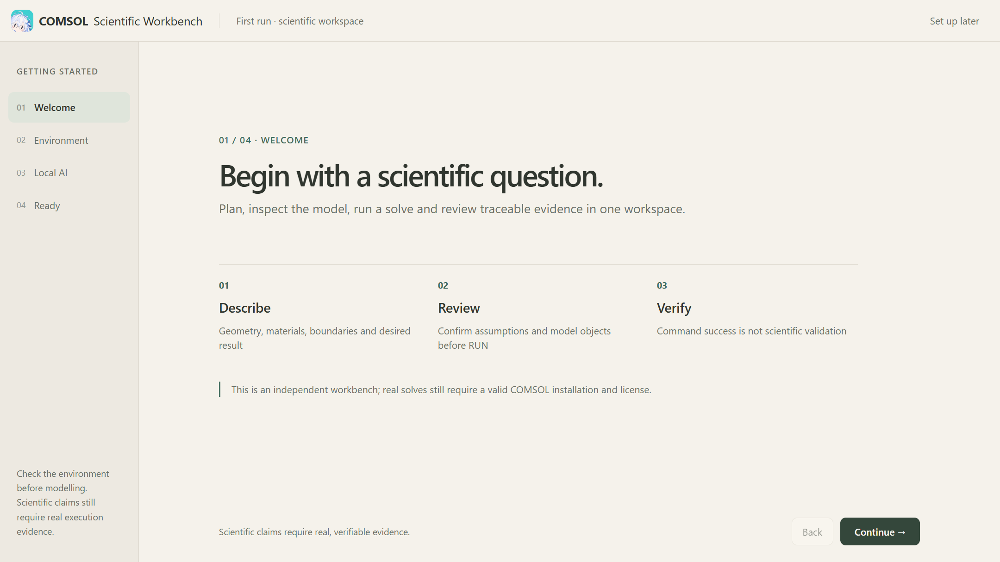
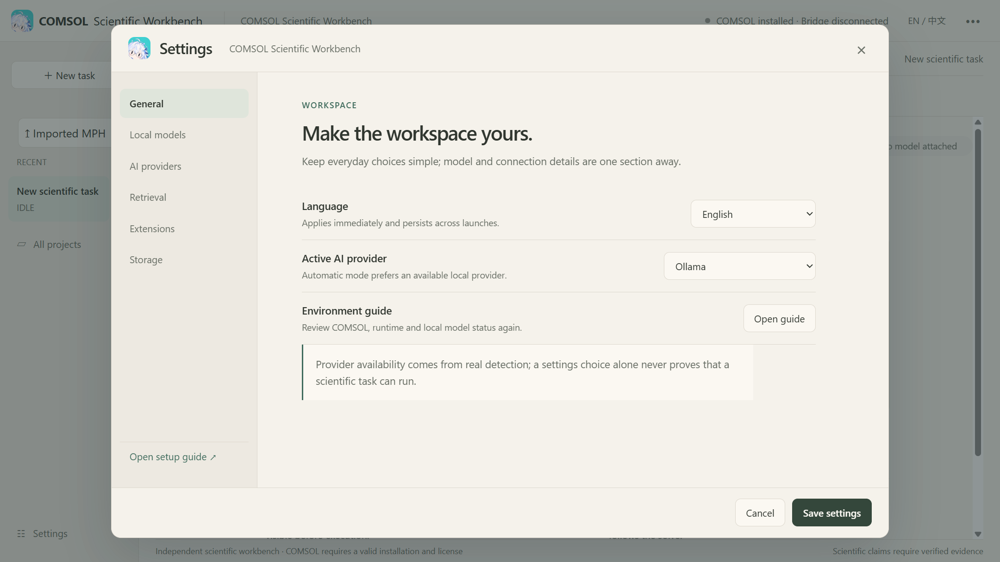
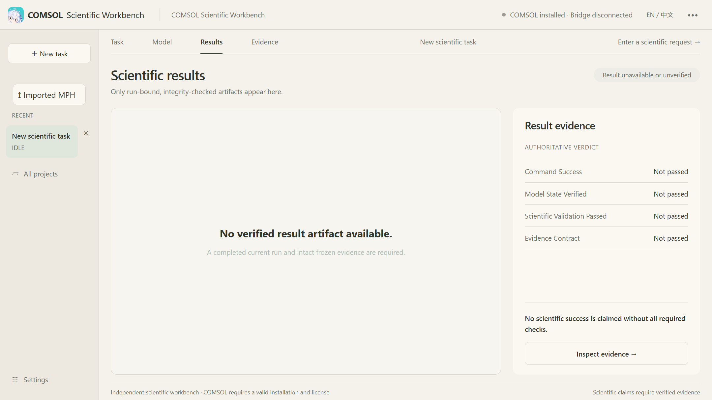

<p align="center">
  
</p>

<h1 align="center">SKY Workbench</h1>
<p align="center"><strong>Official Website & Documentation Center</strong></p>

<p align="center">
  The official home of a local-first AI scientific workbench for COMSOL.<br>
  SKY Workbench 官方网站与文档中心 · 让科学建模过程有迹可循。
</p>

<p align="center">
  <a href="https://lovesky514514-cmd.github.io/scientific-workbench-beta/">官方网站</a>
  ·
  <a href="https://lovesky514514-cmd.github.io/scientific-workbench-beta/docs/">使用文档</a>
  ·
  <a href="https://github.com/lovesky514514-cmd/sky-workbench">软件源码</a>
</p>

<p align="center">
  
  
  
</p>

---

## About / 关于项目

**SKY Workbench** 是一款本地优先的 COMSOL AI 科学工作流助手，围绕自然语言任务、科学建模计划、受控仿真、模型状态读回和证据核验展开。软件本体的源码在独立仓库公开，**本站原创代码和文档不因此自动获得开放再利用授权**。

这个仓库存放的是 **官方网站和文档中心**，不是桌面软件本体。你可以在这里了解项目、浏览真实界面、阅读使用指南，并前往独立的 [SKY Workbench 源码仓库](https://github.com/lovesky514514-cmd/sky-workbench)。

**SKY Workbench** is an independent, local-first scientific workflow assistant for COMSOL. This repository hosts its public-facing website and documentation—not the desktop application or its installer.

> **Release status / 发行状态：** V2.0 源码和文档已公开；Windows Setup 目前仍是内部候选版，仅通过批准的内部渠道提供。本站没有公开 EXE 下载，也不提供在线 COMSOL 求解服务。

## Preview / 界面预览

<p align="center">
  <a href="assets/workbench-desktop-rc51.png">
    
  </a>
</p>
<p align="center"><sub>真实已安装桌面程序截图 · RC5.1（用于界面展示，不代表 V2.0 的完整功能验收）</sub></p>

<table>
  <tr>
    <td align="center"><a href="assets/workbench-onboarding-rc51.png"></a><br><sub>首次使用引导</sub></td>
    <td align="center"><a href="assets/workbench-settings-rc51.png"></a><br><sub>环境与模型设置</sub></td>
    <td align="center"><a href="assets/workbench-results-rc51.png"></a><br><sub>结果与证据复核（未验证状态）</sub></td>
  </tr>
</table>

截图来自既有 RC5.1 安装版记录，未经修图或伪造科学结果；不能据此认定任意物理场、V2.0 安装程序或科学结论已经通过验收。

## Explore / 从这里开始

| 页面 | 内容 |
| --- | --- |
| [产品首页](https://lovesky514514-cmd.github.io/scientific-workbench-beta/) | 项目定位、科学工作流、界面展示与发行说明 |
| [文档中心](https://lovesky514514-cmd.github.io/scientific-workbench-beta/docs/) | 环境要求、首次启动、任务与计划、COMSOL、证据及故障处理 |
| [软件源码](https://github.com/lovesky514514-cmd/sky-workbench) | React / Tauri / Python / Java Bridge 实现及工程文档 |
| [问题反馈](mailto:swbtest001@yeah.net) | 内部测试咨询与脱敏问题反馈 |

## Website features / 网站特点

- **轻量静态站点：** 直接由 GitHub Pages 托管，无须 Node 构建、Worker、D1 或运行中的后端服务。
- **真实产品展示：** 首页轮播四张已安装桌面应用截图，支持手动翻页、暂停与减少动态效果设置。
- **结构化文档：** 中英文内容与按主题组织的帮助信息，方便快速定位安装要求、科学证据含义及常见故障。
- **明确的发行边界：** 区分公开源码、历史截图、内部安装候选版和已经完成的科学验证。

## Repository structure / 目录结构

```text
.
├── index.html          # 产品首页
├── docs/
│   └── index.html      # 文档中心
├── assets/
│   ├── brand-icon.png  # 品牌图标
│   ├── site.css        # 站点样式
│   ├── gallery.js      # 截图轮播
│   └── *.png           # 已安装桌面应用截图
├── test_site.mjs       # 静态站点校验
└── .nojekyll           # GitHub Pages 配置
```

<details>
<summary><strong>Screenshot provenance / 截图来源与 SHA-256</strong></summary>

以下哈希标识已记录的 RC5.1 原始截图；它们仅用于截图完整性核对。

| 文件 | SHA-256 |
| --- | --- |
| `assets/workbench-desktop-rc51.png` | `2DCF7B8C9C952A5E2B48BB7B0A844D03DF0572666AB16565BB7D751609F62220` |
| `assets/workbench-onboarding-rc51.png` | `7D02E5954D59D8279C5FEE0D25223B81D85208E7BA32FA30BC46AB138CE011FA` |
| `assets/workbench-settings-rc51.png` | `D62664D2A613A77E88EE5D6035DA26C7264AA3F8A6D2CA52F3143C7F13E30708` |
| `assets/workbench-results-rc51.png` | `649F9CA6BAE4AE981AD87F1DD8673F848C838BA69ABAE3CD21D5534CE9C32462` |

</details>

## Copyright & permissions / 版权与使用权限

**Copyright © 2026 SuKoYa. All rights reserved. / 保留所有权利。**

本仓库用于展示 SKY Workbench 官网和文档。对于 SuKoYa 有权授权的原创网站代码、文字及其他原创内容，**不提供通用的复制、修改、再发布、独立托管或商业使用许可**。未经事先书面授权，请勿将本站内容用于其他网站、软件或商业项目。公开可浏览并不代表允许任意复用。

This public website repository does **not** grant a general license to copy, modify, redistribute, independently host, or commercially exploit its owner-controlled original website source and documentation. Prior written permission is required, except where applicable law or an existing license permits otherwise.

**Existing licenses remain in effect / 既有授权不受影响：**

- [SKY Workbench 软件主仓库](https://github.com/lovesky514514-cmd/sky-workbench)中的代码另依其适用的 Apache-2.0 及保留的历史、第三方许可处理；本站的版权声明不改变这些授权。
- 官网使用的原创品牌图标沿用主仓库公布的 [CC BY 4.0 素材授权说明](https://github.com/lovesky514514-cmd/sky-workbench/blob/main/docs/ASSET_LICENSE.md)。该许可允许在满足条件时进行商业使用，不能通过本站声明撤销已经授予的权利。
- 桌面界面截图仅用于本项目展示；其中涉及的第三方商标、组件和其他已授权素材仍受各自权利与许可约束。
- GitHub 平台条款及适用法律所赋予的查看、Fork 等权利不受此声明排除。

商业合作或其他使用授权请联系 [swbtest001@yeah.net](mailto:swbtest001@yeah.net)。

## Important notes / 使用边界

真实 COMSOL 建模与求解要求用户自行安装合法的 COMSOL 6.3 软件并持有有效许可。SKY Workbench 是独立第三方项目，不隶属于 COMSOL AB，也不包含 COMSOL、许可文件、私有模型或公开下载的 Windows 安装程序。命令执行成功不等于模型状态已验证，更不等于科学结论通过验证。

网站内容用于介绍软件和提供文档；功能是否可用，以实际环境、受支持的工作流与逐次运行的证据为准。

<p align="center">
  Made by <strong>SuKoYa</strong> · © 2026<br>
  <a href="https://lovesky514514-cmd.github.io/scientific-workbench-beta/">Website</a> ·
  <a href="https://github.com/lovesky514514-cmd/sky-workbench">Source</a> ·
  <a href="mailto:swbtest001@yeah.net">Contact</a>
</p>
